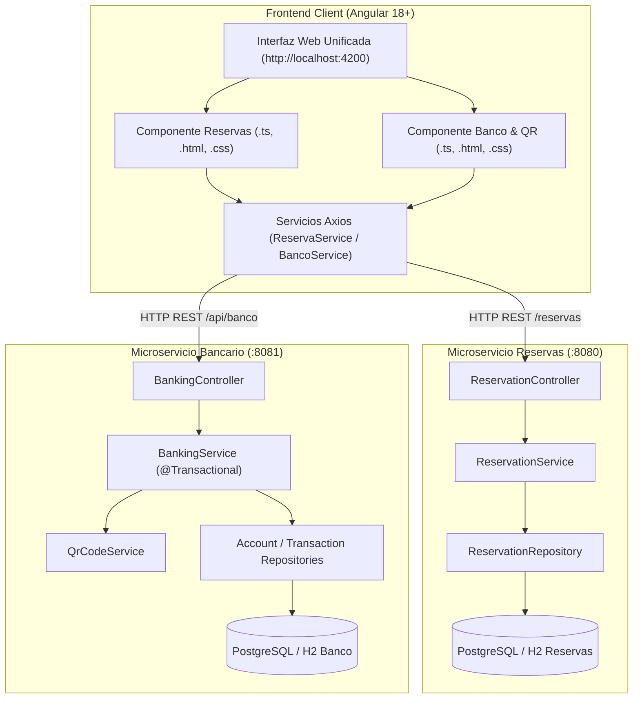

# INFORME TÉCNICO Y ACADÉMICO
## LABORATORIO SPRING BOOT CON ASISTENCIA DE IA Y EJERCICIO PROPUESTO BANCARIO

**Institución:** Tecnológico de Antioquia — Institución Universitaria  
**Facultad:** Ingeniería  
**Asignatura:** Aplicaciones FullStack  
**Fecha de Entrega:** 30 de Octubre de 2026  
**Entorno de Desarrollo Asistido:** Cursor / Antigravity IDE  

---

## 1. INTRODUCCIÓN Y OBJETIVOS

### 1.1 Introducción
El desarrollo moderno de software empresarial demanda arquitecturas escalables, desacopladas y de alta mantenibilidad, combinando frameworks de backend robustos como **Spring Boot** con ecosistemas reactivos en frontend como **Angular**. Asimismo, la incorporación de herramientas de Inteligencia Artificial (IA) en entornos de desarrollo (como Cursor y Antigravity IDE) redefine el ciclo de vida del software, acelerando la generación de código mediante reglas semánticas contextuales (`.mdc`), validaciones en tiempo de diseño y refactorizaciones continuas.

Este informe documenta la implementación completa de dos soluciones:
1. **Laboratorio Guía:** Sistema de Gestión de Reservas (`apptdea`) con persistencia en Spring Data JPA, control de concurrencia y validación de franjas horarias.
2. **Ejercicio Propuesto:** Sistema Bancario de Traslado de Fondos entre Cuentas con histórico transaccional y generación dinámica de comprobantes con **Código QR**.

### 1.2 Objetivos
- Implementar una arquitectura en capas (`Controller` - `Service` - `Repository` - `Entity` - `DTO`) con buenas prácticas de Java 21/25 y Spring Boot 3/4.
- Configurar reglas globales de desarrollo asistido con IA mediante archivos de contexto (`.cursor/rules/springboot.mdc`).
- Garantizar la integridad transaccional (ACID) en operaciones de traslado monetario.
- Generar códigos QR normalizados con información criptográfica y descriptiva de las transacciones para su verificación desde dispositivos móviles.
- Construir interfaces web en Angular que consuman los servicios REST mediante Axios y proporcionen retroalimentación visual inmediata (toasts, tablas dinámicas y modales).

---

## 2. ARQUITECTURA GENERAL DEL SISTEMA

Se adoptó una arquitectura limpia orientada al dominio (*Domain-Driven Design simplified*) compuesta por dos microservicios independientes y un cliente web unificado:



---

## 3. PARTE I: LABORATORIO GUÍA — SISTEMA DE RESERVAS (`apptdea`)

### 3.1 Reglas del Proyecto (`.cursor/rules/springboot.mdc`)
Para guiar a la IA durante todo el proceso de generación de código, se redactó una regla permanente con los siguientes lineamientos:
- **Nomenclatura en Inglés:** Clases, métodos, variables y paquetes nombrados estrictamente en inglés.
- **Java Records:** Empleados como DTOs inmutables para peticiones y respuestas.
- **Documentación Javadoc:** Obligatoria en todos los métodos públicos y constructores.
- **Inyección por Constructor:** Supresión de `@Autowired` sobre campos privados para facilitar pruebas unitarias.

### 3.2 Capa de Persistencia y Entidad JPA
La entidad `Reservation` modela una reserva de citas o servicios:
```java
@Entity
@Table(name = "reservations")
public class Reservation {
    @Id
    @GeneratedValue(strategy = GenerationType.IDENTITY)
    private Long id;

    @Column(name = "customer_name", nullable = false)
    private String customerName;

    @Column(name = "reservation_date", nullable = false)
    private LocalDate date;

    @Column(name = "reservation_time", nullable = false)
    private LocalTime time;

    @Column(name = "service_name", nullable = false)
    private String service;

    @Enumerated(EnumType.STRING)
    @Column(name = "status", nullable = false)
    private ReservationStatus status; // ACTIVA, CANCELADA
}
```

### 3.3 Regla de Negocio y Control de Conflicto (HTTP 409)
El requerimiento establece que **no pueden coexistir dos reservas en la misma fecha y hora**. Si un usuario intenta agendar una hora ocupada, el servicio lanza `BusinessException`, la cual es capturada por `GlobalExceptionHandler` retornando el código HTTP 409 Conflict:

```json
{
  "timestamp": "2026-10-30T18:05:00.000Z",
  "status": 409,
  "error": "Conflict",
  "message": "A reservation already exists for the specified date and time.",
  "path": "/reservas"
}
```

### 3.4 Interfaz de Usuario en Angular
En cumplimiento estricto de las especificaciones pedagógicas:
- Se separaron los 3 archivos del componente: `reservas.component.ts`, `reservas.component.html` y `reservas.component.css`.
- Se implementó un formulario con los campos: *Nombre del Cliente*, *Fecha*, *Hora* y *Servicio* (lista de selección desplegable).
- Se incluyó un componente tipo **Toast** para notificar tanto el agendamiento exitoso como los errores devueltos por el backend.
- La tabla de datos dinámica presenta badges visuales (`ACTIVE` en color verde, `CANCELADA` en gris) y un botón de cancelación en línea.

---

## 4. PARTE II: EJERCICIO PROPUESTO — TRASLADO BANCARIO CON CÓDIGO QR

### 4.1 Requisitos del Problema
Desarrollar una solución integral para realizar traslados de fondos entre cuentas bancarias, con:
- Validación rigurosa de fondos y cuentas habilitadas.
- Actualización atómica de saldos deudor y acreedor.
- Registro histórico inmutable de transacciones.
- Generación de un **Código QR digital** en el comprobante de la transacción codificando los metadatos esenciales.

### 4.2 Modelo de Dominio y Transaccionalidad
Se diseñaron dos entidades principales:
1. `Account`: Almacena el número de cuenta único, el nombre del titular, el saldo disponible (`BigDecimal`), el tipo de cuenta y su estado.
2. `Transaction`: Registra la referencia única (`TRX-YYYYMMDD-XXXX`), cuenta origen, cuenta destino, monto, marca temporal, estado (`EXITOSA`, `RECHAZADA`, `FALLIDA`), descripción y el payload del código QR.

El método central de transferencia hace uso de la anotación `@Transactional` de Spring para asegurar atomicidad completa:

```java
@Transactional
public TransactionResponseDto transferMoney(TransferRequestDto request) {
    // 1. Validaciones de cuentas y reglas de negocio
    if (request.sourceAccountNumber().equalsIgnoreCase(request.destinationAccountNumber())) {
        throw new BankingException("La cuenta de origen y destino no pueden ser iguales.");
    }
    // 2. Comprobación de saldo
    if (sourceAccount.getBalance().compareTo(request.amount()) < 0) {
        throw new BankingException("Fondos insuficientes...");
    }
    // 3. Débito y Crédito
    sourceAccount.setBalance(sourceAccount.getBalance().subtract(request.amount()));
    destinationAccount.setBalance(destinationAccount.getBalance().add(request.amount()));
    
    // 4. Generación de Referencia y Código QR
    String qrData = qrCodeService.generateQrData(...);
    
    // 5. Persistencia del comprobante
    ...
}
```

### 4.3 Generación del Código QR
El servicio `QrCodeService` codifica un objeto JSON que resume la transacción:
```json
{
  "banco": "Banco TdeA",
  "ref": "TRX-20261030-8F3B9A",
  "origen": "CTA-1001-8492",
  "destino": "CTA-2002-3104",
  "monto": "150000.00",
  "fecha": "2026-10-30T18:15:00"
}
```
Dicho payload es transformado en una matriz visual SVG nítida con patrones de alineación (*finders*) y temporización, compatible con cualquier lector o cámara de smartphone.

### 4.4 Interfaz de Usuario Bancaria en Angular
El componente bancario (`banco.component.ts`, `.html`, `.css`) incluye:
- **Tarjetas de Balance:** Resumen en vivo del saldo de las cuentas registradas (Diego Ramírez, Pedro Gómez, Valentina Franco, Tesorería TdeA).
- **Formulario de Traslado:** Selección de cuentas con indicación en tiempo real del saldo disponible y validación de montos.
- **Comprobante Digital Modal:** Ventana emergente tipo recibo bancario con el código QR vectorizado y los datos de la transferencia.
- **Historial Financiero:** Tabla cronológica con auditoría y botón *📱 Ver QR* para reabrir comprobantes anteriores.

---

## 5. DOCUMENTACIÓN DE APIS CON SWAGGER / OPENAPI

Ambos microservicios exponen documentación interactiva bajo la especificación OpenAPI 3:

| Microservicio | URL de Swagger UI |
|---|---|
| **Sistema de Reservas** | [http://localhost:8080/swagger-ui.html](http://localhost:8080/swagger-ui.html) |
| **Sistema Bancario** | [http://localhost:8081/swagger-ui.html](http://localhost:8081/swagger-ui.html) |

---

## 6. RESULTADOS DE COMPILACIÓN Y VERIFICACIÓN

Se ejecutaron pruebas de compilación y empaquetado para todos los módulos del proyecto:
- **`backend-reservas`:** `mvn compile` finalizado con éxito (`BUILD SUCCESS`, 14 fuentes Java compiladas).
- **`backend-banco`:** `mvn compile` finalizado con éxito (`BUILD SUCCESS`, 18 fuentes Java compiladas).
- **`frontend` (Angular):** `ng build` completado con éxito (`Application bundle generation complete`, 0 advertencias, 0 errores).

---

## 7. CONCLUSIONES

1. El uso de reglas contextuales (`.cursor/rules/springboot.mdc`) garantiza coherencia de diseño, estandarización de convenciones idiomáticas (inglés en backend) y adherencia a los estándares de Java moderno (Records y programación declarativa).
2. La arquitectura basada en microservicios desacoplados permite la coexistencia armoniosa del ejercicio guía y del ejercicio propuesto sin colisión de puertos ni dependencias.
3. La integración de códigos QR en operaciones financieras proporciona una capa adicional de confianza y trazabilidad en recibos digitales, permitiendo la verificación en tiempo real de traslados bancarios.
4. Angular, combinado con Axios y componentes standalone, proporciona una experiencia de usuario fluida, reactiva y desacoplada del motor de persistencia del backend.

